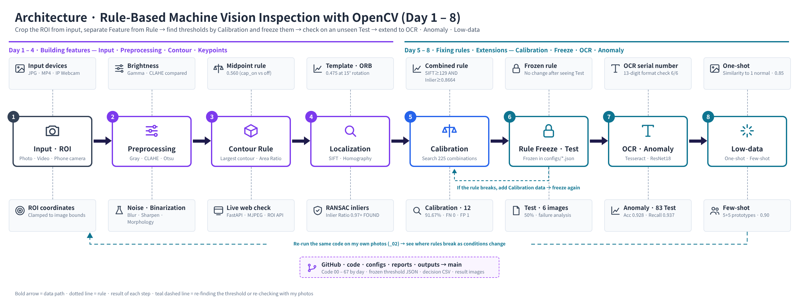
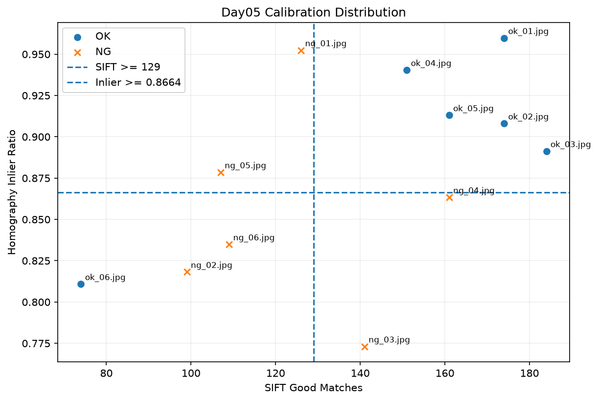
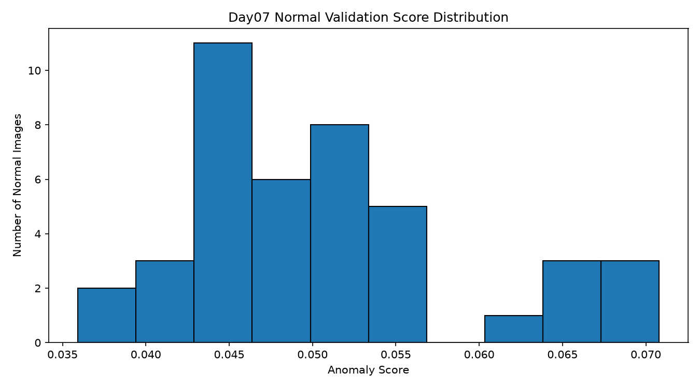
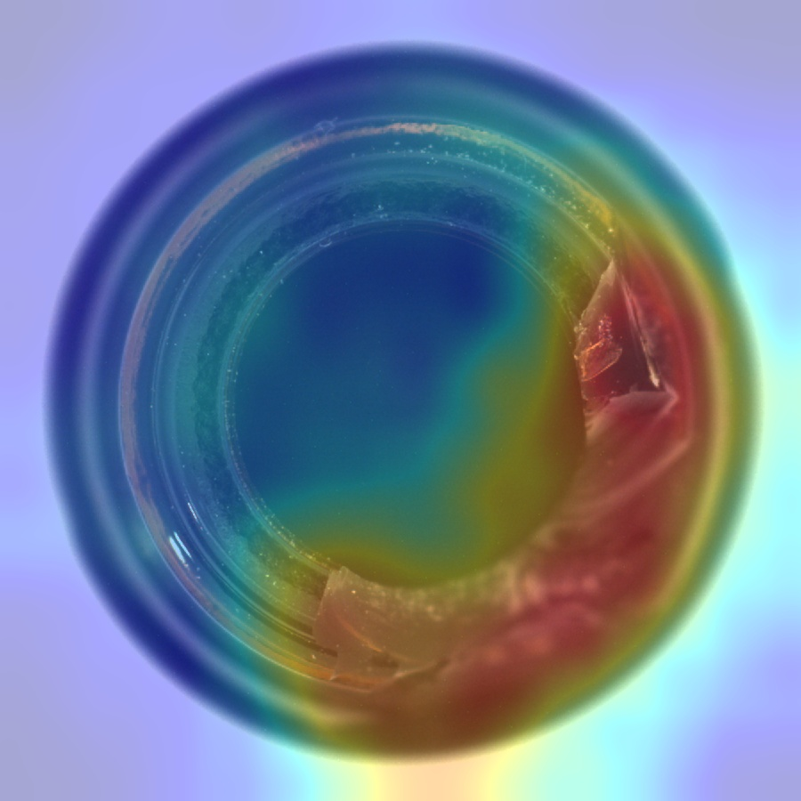
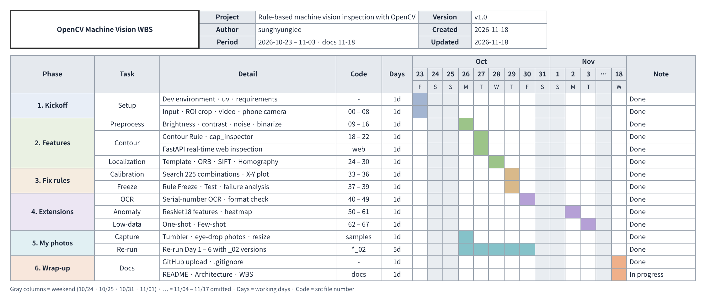

# opencv-machine-vision-inspection-project — Rule-Based Machine Vision Inspection with OpenCV

<p align="right"><a href="README.md">한국어</a> | <b>English</b></p>

<p align="center">
  
  
  
  
  
  
  <br>
  
  
  
  
</p>

## Project Overview

### Architecture

The ROI is cropped from camera or photo input, and preprocessing → measurement (Feature) → decision (Rule) are kept separate. Thresholds were always **set on Calibration data, frozen, and then checked on an unseen Test**, and the same code was **re-run on photos I took myself (`_02`)** to see where the rules break.



<br>

### Summary

A hands-on rule-based machine vision project with OpenCV. From Day 1 to Day 8 it implements, step by step, how to judge cap presence, logo position, serial-number text and bottle defects **with rules instead of training**.

The goal is not a high score but **finding where rules work and where they break**. Measurement and decision are separated, thresholds come from Calibration data rather than guesswork, and no threshold was changed after looking at the Test set.

<br>

### Results

The same code was also **re-run on photos I took myself (a tumbler logo and an eye-drop label)** to see the limits of the rules.

| Stage | Method | Key result |
|---|---|---|
| Day 3 · Contour Rule | Otsu → Morphology → Area Ratio of the largest contour · midpoint threshold | Cap Test **4/4** · my photos **0/4** once the logo size changed |
| Day 4 · Localization | Template · ORB · SIFT · Homography (RANSAC) | Template drops from 0.9997 to **0.475** at 15° rotation · Homography stays **FOUND with Inlier Ratio ≥ 0.97** under shift, rotation and scale |
| Day 5 · Combined Rule | SIFT Good Match ≥ 129 **AND** Inlier Ratio ≥ 0.8664 (225 combinations searched) | Calibration 12 images **91.67%** → Test 6 images **50%** (FN 0 · FP 3) |
| Day 6 · OCR | Serial-number ROI · Tesseract psm 7 · digit whitelist · 13-digit format check | Inspection decision **6/6** · original image works best, Otsu causes misreads |
| Day 7 · Anomaly | ResNet18 layer3 mean normal feature · 95th percentile of normal validation scores | Test 83 images Accuracy **0.928** · Recall **0.937** · Precision **0.967** |
| Day 8 · Low-data | One-shot (similarity to 1 normal image) · Few-shot (5 normal + 5 defect prototypes) | One-shot **0.85** → Few-shot **0.90** |

**Calibration and Test scores were always recorded separately**, and re-running the same code on my own photos put numbers on how sensitive rule-based inspection is to capture conditions.

**Why I re-ran it on my own photos**

- **The practice photos have fixed conditions** — the same lighting, distance and angle, so the rules fit well. To see what happens when conditions change, as they do on a real line, I needed different data.
- **Thresholds are tied to their data** — the Day 3 midpoint 0.560 and the Day 5 values 129 / 0.8664 were computed on the practice photos. My photos needed a new Calibration (Day 5: 197 / 0.6497), and the Test still reached only **66.7%**.
- **Decision** — the base code and results are kept as they are; my runs are stored separately as `_02` code, `_02` configs and `_02` results so the two can be compared side by side.

<br>

### Improvements

Solving the same problem with one feature → two features → learned features showed how decisions become stable under changing conditions. Replacing Template matching (0.475 at 15° rotation) with SIFT + Homography made localization **FOUND under rotation and scale**, and the bottle inspection, built from normal images only, **detected 59 of 63 defects**.

| Key metric | Result |
|---|---|
| Scope | Day 1 – 8 · code numbers `00` – `67` · base version + my-photo `_02` version |
| Decision design | Feature and Rule separated · thresholds frozen in `configs/*.json` |
| Validation rule | Calibration → Rule Freeze → Test · no threshold change after Test |
| Key lesson | Calibration 91.67% → Test 50% · overlapping values cannot be split by one threshold |
| Best performance | Day 7 Anomaly Accuracy 0.928 · Recall 0.937 |

Evidence → [reports](reports) · [configs](configs)

<br>

### Screens

| Day 5 · Calibration feature distribution | Day 7 · Normal validation score distribution |
|---|---|
|  |  |

<p align="center"></p>

*Day 7 · Regions that differ from the normal mean, shown as a heatmap.*

<br>

### Shortcuts

| Folder | What it is | Key point |
|---|---|---|
| [**src**](src) | Practice code by day (`00` – `67`) · my-photo `_02` versions | Run in number order |
| [**configs**](configs) | Frozen thresholds (Rule Freeze) | `day05_logo_rules.json` · `day07_anomaly_rules.json`, etc. |
| [**reports**](reports) | Decision CSVs · metrics | Calibration · Test · Challenge results |
| [**outputs**](outputs) | Result images | ROI · preprocessing · contour · matching · heatmap |
| [**samples**](samples) | Input photos · video | Practice photos + my own photos |
| [**web**](web) · `src/fastapi_cap_app.py` | Real-time cap inspection web app with a phone camera | MJPEG stream · ROI API |

| Day | 1 | 2 | 3 | 4 | 5 | 6 | 7 | 8 |
|---|---|---|---|---|---|---|---|---|
| Topic | Input · ROI | Preprocess | Contour · Web | Localize | Calibration | OCR | Anomaly | Few-shot |
| Code | `00~08` | `09~16` | `18~22` | `24~30` | `33~39` | `40~49` | `50~61` | `62~67` |

<br>

### WBS Schedule



*Day 1 – 8 follow class days · `_02` re-runs were done on the same day as each lesson · Code = file number in `src/`.*

<br><br>

## Quick Start

Requirements: Windows 11 PC · WSL2 Ubuntu · Tesseract for Day 6 OCR · GPU recommended for Day 7 – 8

**Step 1 · Clone**

```bash
git clone https://github.com/sunghyunglee/opencv-machine-vision-inspection-project.git
cd opencv-machine-vision-inspection-project
```

**Step 2 · Install**

```bash
python3 -m venv .venv && source .venv/bin/activate
pip install -r requirements.txt
sudo apt install -y tesseract-ocr
```

**Step 3 · Run** — keep the terminal in the project folder and run the code in `src/` in number order

```bash
python src/00_check_env.py
python src/21_cap_rule.py
python src/37_day05_test.py
python src/56_day07_test_anomaly.py
```

Real-time web inspection (Day 3)

```bash
python -m uvicorn fastapi_cap_app:app --app-dir src --host 127.0.0.1 --port 8000
```

<br><br>

## Notes

- Bottle images for Day 7 – 8 are from the MVTec AD dataset (bottle) — CC BY-NC-SA 4.0 · non-commercial use · https://www.mvtec.com/company/research/datasets/mvtec-ad
- Code, configs and results with `_02` are the versions re-run on my own photos.
