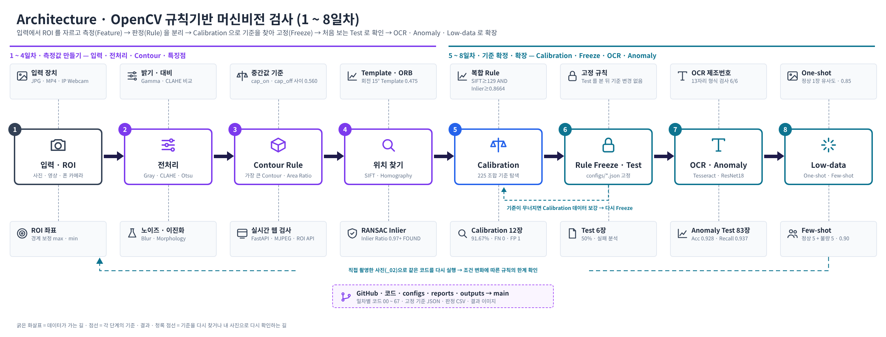
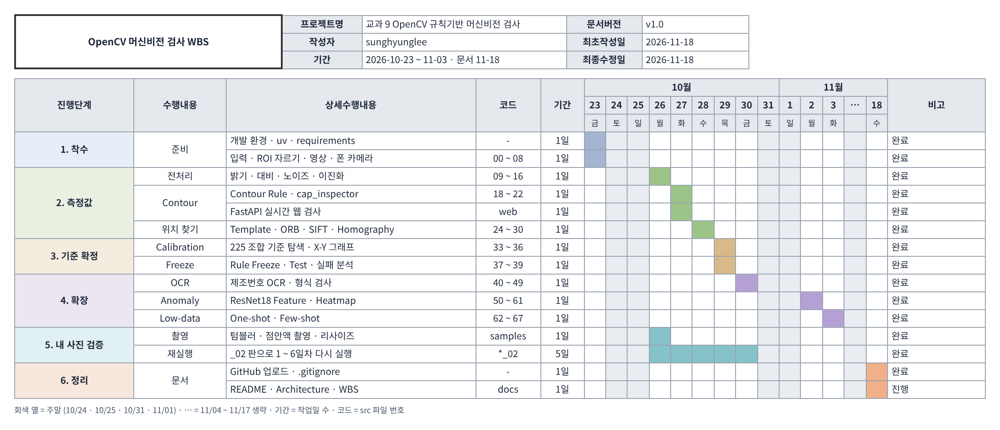
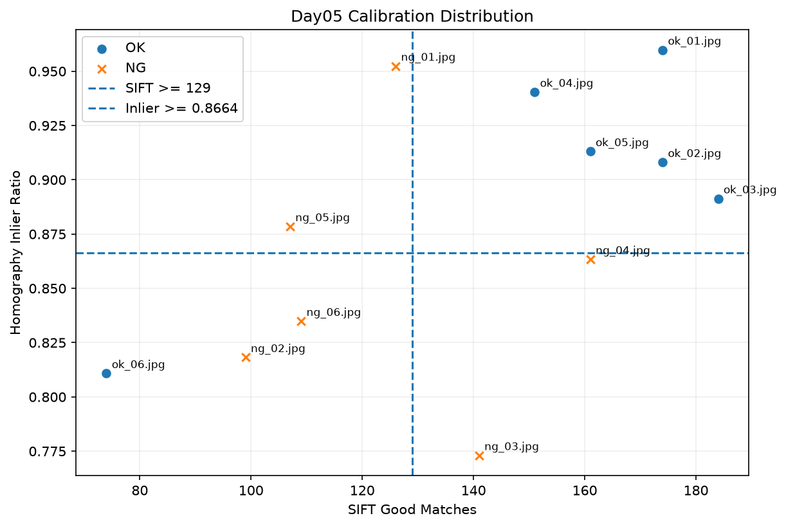
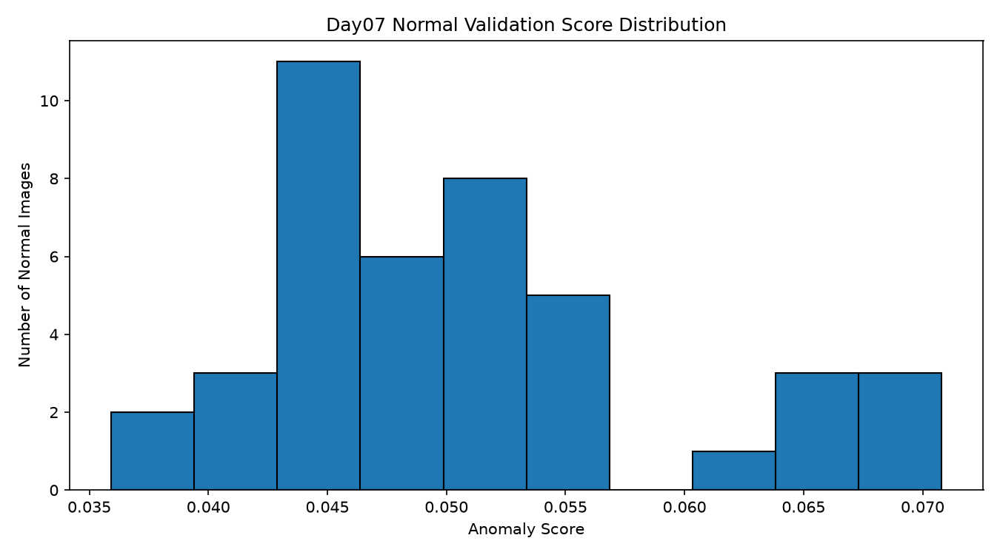
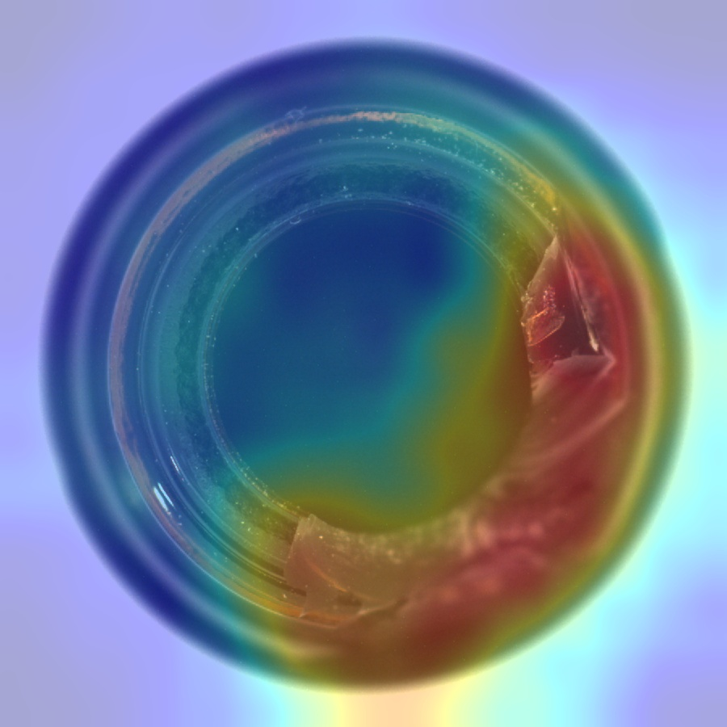

# opencv-machine-vision-inspection-project — OpenCV 규칙기반 머신비전 검사

<p align="right"><b>한국어</b> | <a href="README.en.md">English</a></p>

<p align="center">
  
  
  
  
  
  
  <br>
  
  
  
  
</p>

## 프로젝트 소개

### Architecture

카메라 · 사진 입력에서 ROI 를 자르고, 전처리 → 측정(Feature) → 판정(Rule) 을 분리했습니다. 기준값은 항상 **Calibration 데이터로 정하고 고정(Freeze)한 뒤 처음 보는 Test 로 확인**했고, 같은 코드를 **직접 촬영한 사진(`_02`)으로 다시 실행**해 규칙의 한계를 확인했습니다.



<br>사진 · 영상 · 폰 카메라] --> B[ROI 자르기]
    B --> C[전처리<br>Gray · CLAHE · Blur · Otsu]
    C --> D{측정 Feature}
    D --> D1[Contour<br>Area Ratio]
    D --> D2[Template · ORB · SIFT<br>Homography]
    D --> D3[OCR<br>Tesseract]
    D --> D4[ResNet18 특징<br>거리 · 유사도]
    D1 & D2 & D3 & D4 --> E[Calibration<br>기준값 탐색]
    E --> F[Rule Freeze<br>configs/*.json]
    F --> G[Test · Challenge<br>reports/*.csv]
    G --> H[FastAPI 웹<br>MJPEG · WebSocket]
```

<br>

### 개요

OpenCV 규칙기반 머신비전 실습 프로젝트입니다. 병뚜껑 유무 · 로고 위치 · 제조번호 문자 · 병 불량을 **학습 없이 규칙(Rule)으로 판정**하는 과정을 1일차부터 8일차까지 단계별로 구현했습니다.

목표는 높은 점수가 아니라 **규칙이 어디까지 통하고 어디서 무너지는지 확인**하는 것입니다. 측정과 판정을 분리하고, 기준값은 감이 아니라 Calibration 데이터로 찾고, Test 를 본 뒤에는 기준을 고치지 않았습니다.

<br>

### 작업 결과

같은 코드를 **직접 촬영한 사진(텀블러 로고 · 점안액 라벨)으로 다시 실행**해 규칙의 한계도 함께 확인했습니다.

| 단계 | 방법 | 핵심 결과 |
|---|---|---|
| 3일차 · Contour Rule | Otsu → Morphology → 가장 큰 Contour 의 Area Ratio · 중간값 기준 | 병뚜껑 Test 4장 **4/4** · 내 사진은 로고 크기가 바뀌자 **0/4** |
| 4일차 · 위치 찾기 | Template · ORB · SIFT · Homography(RANSAC) | Template 은 회전 15° 에서 0.9997 → **0.475** · Homography 는 이동 · 회전 · 축소 모두 Inlier Ratio **0.97 이상 FOUND** |
| 5일차 · 복합 Rule | SIFT Good Match ≥ 129 **AND** Inlier Ratio ≥ 0.8664 (225 조합 탐색) | Calibration 12장 **91.67%** → Test 6장 **50%** (FN 0 · FP 3) |
| 6일차 · OCR | 제조번호 ROI · Tesseract psm 7 · 숫자 whitelist · 13자리 형식 검사 | 6장 검사 판정 **6/6** · 전처리는 원본이 최선, Otsu 는 오인식 |
| 7일차 · Anomaly | ResNet18 layer3 정상 평균 특징 · 정상 검증 95 퍼센타일 기준 | Test 83장 Accuracy **0.928** · Recall **0.937** · Precision **0.967** |
| 8일차 · Low-data | One-shot(정상 1장 유사도) · Few-shot(정상 5 + 불량 5 프로토타입) | One-shot **0.85** → Few-shot **0.90** |

특히 **Calibration 점수와 Test 점수를 분리해서 기록**하고, 같은 코드를 내 사진에 다시 적용해 규칙 기반 검사가 촬영 조건에 얼마나 민감한지 숫자로 남겼습니다.

**내 사진으로 다시 실행한 이유**

- **실습 사진은 조건이 고정되어 있음** — 같은 조명 · 거리 · 각도라 규칙이 잘 맞습니다. 실제 현장처럼 조건이 바뀌면 어떻게 되는지 확인하려면 다른 데이터가 필요했습니다.
- **기준값은 데이터에 묶여 있음** — 3일차 중간값 0.560 · 5일차 129 / 0.8664 는 실습 사진에서 계산된 값입니다. 내 사진에서는 Calibration 을 다시 해야 했고(5일차 197 / 0.6497), 그래도 Test 는 **66.7%** 였습니다.
- **결정** — 기본 코드와 결과는 그대로 두고, 내 사진 실습은 `_02` 파일 · `_02` 설정 · `_02` 결과로 따로 남겨 두 결과를 나란히 비교합니다.

<br>

### WBS 일정



*1 ~ 8일차는 수업일 기준 · `_02` 재실행은 해당 일차와 같은 날 진행 · 코드 = `src/` 파일 번호입니다.*

<br>

### 개선 효과

같은 문제를 측정값 하나 → 측정값 둘 → 학습된 특징 순서로 풀면서, 조건 변화에 대한 판정이 안정되는 과정을 확인했습니다. 위치 찾기는 Template(회전 15° 에서 0.475) 대신 SIFT + Homography 로 바꿔 **회전 · 축소에서도 모두 FOUND** 가 됐고, 병 불량 검사는 정상 사진만으로 만든 기준으로 **불량 63장 중 59장을 검출**했습니다.

| 핵심 지표 | 결과 |
|---|---|
| 구성 | 1 ~ 8일차 · 코드 번호 `00` ~ `67` · 기본 판 + 내 사진 `_02` 판 |
| 판정 방식 | 측정(Feature) 과 판정(Rule) 분리 · 기준은 `configs/*.json` 에 고정 |
| 검증 원칙 | Calibration → Rule Freeze → Test · Test 를 본 뒤 기준 변경 없음 |
| 대표 교훈 | Calibration 91.67% → Test 50% · 값이 겹치면 기준 하나로는 못 나눔 |
| 최고 성능 | 7일차 Anomaly Accuracy 0.928 · Recall 0.937 |

근거 → [reports](reports) · [configs](configs)

<br>

### 작동 화면

| 5일차 · Calibration 측정값 분포 | 7일차 · 정상 검증 점수 분포 |
|---|---|
|  |  |



*7일차 · 정상 평균과 다른 영역을 Heatmap 으로 표시한 결과입니다.*

<br>

### 바로가기

| 폴더 | 무엇인가 | 핵심 |
|---|---|---|
| [**src**](src) | 일차별 실습 코드 (`00` ~ `67`) · 내 사진판 `_02` | 번호 순서대로 실행 |
| [**configs**](configs) | 고정한 기준값 (Rule Freeze) | `day05_logo_rules.json` · `day07_anomaly_rules.json` 등 |
| [**reports**](reports) | 판정 결과 CSV · 지표 | Calibration · Test · Challenge 결과 |
| [**outputs**](outputs) | 결과 이미지 | ROI · 전처리 · Contour · 매칭 · Heatmap |
| [**samples**](samples) | 입력 사진 · 영상 | 실습 사진 + 직접 촬영 사진 |
| [**web**](web) · `src/fastapi_cap_app.py` | 폰 카메라 실시간 병뚜껑 검사 웹 | MJPEG 스트림 · ROI 지정 API |

| 일차 | 주제 | 코드 |
|---|---|---|
| 1 | 이미지 · 영상 · 웹캠 · 폰 카메라 입력과 ROI | `00` ~ `08` |
| 2 | 색 공간 · 밝기 · Gamma · CLAHE · Filter · Sharpen · Otsu | `09` ~ `16` |
| 3 | Morphology · Contour · Area Ratio Rule · 실시간 웹 검사 | `18` ~ `22` · `cap_inspector.py` · `fastapi_cap_app.py` |
| 4 | GrabCut · MeanShift · Template · ORB · SIFT · Homography | `24` ~ `30` |
| 5 | Calibration · 복합 Rule · Rule Freeze · Test · 실패 분석 | `33` ~ `39` |
| 6 | OCR 제조번호 검사 | `40` ~ `49` |
| 7 | Anomaly Detection (MVTec AD bottle) · Heatmap · Challenge | `50` ~ `61` |
| 8 | One-shot · Few-shot | `62` ~ `67` |

<br><br>

## 빠른 시작

준비물: Windows 11 PC · WSL2 Ubuntu · 6일차 OCR 에는 Tesseract · 7 ~ 8일차는 GPU 권장

**1단계 · 받기**

```bash
git clone https://github.com/sunghyunglee/opencv-machine-vision-inspection-project.git
cd opencv-machine-vision-inspection-project
```

**2단계 · 설치**

```bash
python3 -m venv .venv && source .venv/bin/activate
pip install -r requirements.txt
sudo apt install -y tesseract-ocr
```

**3단계 · 실행** — 터미널 위치는 프로젝트 폴더, 코드는 `src/` 에서 번호 순서대로

```bash
python src/00_check_env.py
python src/21_cap_rule.py
python src/37_day05_test.py
python src/56_day07_test_anomaly.py
```

실시간 웹 검사 (3일차)

```bash
python -m uvicorn fastapi_cap_app:app --app-dir src --host 127.0.0.1 --port 8000
```

<br><br>

## 주의사항

- 7 ~ 8일차 병 사진은 MVTec AD dataset (bottle) 입니다 — CC BY-NC-SA 4.0 · 비상업 용도 · https://www.mvtec.com/company/research/datasets/mvtec-ad
- `_02` 가 붙은 코드 · 설정 · 결과는 직접 촬영한 사진으로 다시 실행한 버전입니다.
